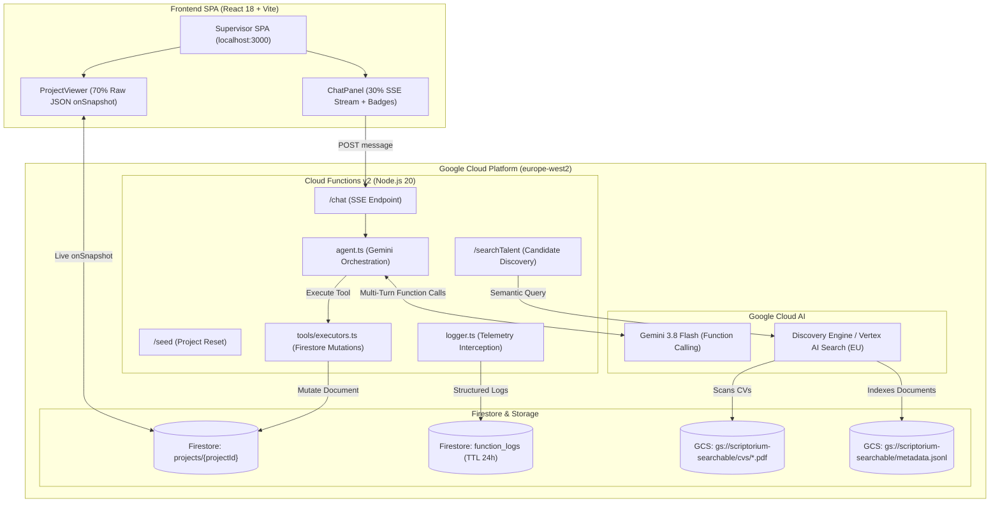

# Scriptorium Talent Hub - Architectural Log & Developer Reference

## Overview & Mission
**Scriptorium Talent Hub** is an agentic, productised talent-management platform and supervisory system designed for creative, localisation, and marketing teams.

- **GCP Project**: `scriptorium-503507`
- **Region**: `europe-west2` (London, UK — strictly enforced for all infrastructure)
- **Core Value Proposition**: Replaces the expensive in-house talent/resource manager by providing a done-for-you, subscription-based service that sources, tests, builds, and maintains private, ready-to-book freelance talent pools with guaranteed 24–48 hour rapid fills.
- **Current Technical Implementation**:
  - **Supervisor Console SPA**: React 18 + TypeScript + Vite + Tailwind CSS featuring a 70/30 split view (70% live Firestore project/pool document viewer, 30% chat console with tool badges and SSE streaming).
  - **Backend Cloud Functions v2**: Node.js 20 / TypeScript endpoints deployed in `europe-west2` providing SSE agent chat (`/chat`), project seeding (`/seed`), and semantic talent search (`/searchTalent`).
  - **Autonomous Agent**: Native Gemini 3.8 Flash (`@google/genai`) function calling agent executing verified state mutations on Firestore documents with thought signature preservation.
  - **Semantic Candidate Search**: Google Cloud Discovery Engine (Vertex AI Search) indexing talent CVs in Google Cloud Storage (`gs://scriptorium-searchable`) with structured JSONL metadata.
  - **Centralised Telemetry**: Real-time console interception and structured logging to the Firestore `function_logs` collection with 24-hour TTL and automated test teardown reporting.

---

## Part I: Business Plan & Product Strategy

### 1. Executive Summary
Scriptorium Talent Hub replaces the in-house talent manager. Creative agencies, localisation teams, and marketing scale-ups typically employ or overload staff to find, vet, onboard, and coordinate freelancers. Scriptorium performs this entire lifecycle at a fraction of the cost.

Clients receive a private, vetted, ready-to-book talent pool, kept continually active and topped up whenever new skills are required. Clients pay a predictable monthly subscription based on pool size and scope.

### 2. The Problem
1. **High Cost**: A dedicated talent or resource manager commands a full salary (£35k–£60k+) plus overhead, which small and mid-sized agencies (10–200 staff) cannot justify.
2. **Reactive Panic-Searching**: When a brief arrives, teams scramble across fragmented platforms to find available talent.
3. **Inconsistent & Unverified Vetting**: Portfolios and CVs fail to verify real craft quality under deadline pressure, and agency leads lack the bandwidth to design and mark tests.
4. **Stale Pools**: Freelancers become unavailable, update rates, or slip in quality without systematic tracking.
5. **Hard-to-Fill Multidisciplinary Roles**: Niche cross-discipline roles (such as transcreation, AI post-editing, and bilingual client service) are notoriously difficult to source through commodity freelance platforms.

### 3. Talent Disciplines Covered
Scriptorium curates and rigorously tests talent across key creative and linguistic domains:
- **Copywriters & Content Writers**: Timed brief written to style guide, evaluating tone range and persuasion.
- **Transcreation Specialists**: Adaptation of brand campaign copy for cultural resonance with rationales.
- **AI Post-Editors**: Review of machine translation and AI-generated copy, turning raw outputs into polished, publication-ready prose across error categories.
- **Translators, Reviewers & Language QA**: Domain-specific translation samples scored by senior linguists.
- **Project Managers & Producers**: Scenario-based evaluation of scope, timeline, risk, and stakeholder management.
- **Account Managers & Client Services**: Role-play and written communication for client escalation and briefs.
- **Visual & Audio Disciplines**: Subtitling specialists, Voice-Over artists, Graphic Designers, Creative Directors, Social Media Creators, and Brand Strategists.

### 4. Competitor Analysis & Strategic Moat

| Competitor | Business Model | Threat Level | Scriptorium Moat & Gap Exploited |
| :--- | :--- | :--- | :--- |
| **YunoJuno** | Freelancer management system + vetted marketplace; percentage markup on freelancer rates (approx 12%). | High (Creative) | Self-service: client still shortlists and manages pools; enterprise-priced; not language-specialised; no provider-run testing. |
| **Cavalry Freelancing** | Roster management platform with AI matching; booking and invoicing. | High (Creative) | Self-service tool. Clients still do the talent-manager work; no language/transcreation specialism. |
| **Language Talent Pool** | Recruitment agency and job board for language professionals; per-placement fees. | Medium–High (Language) | People-dependent, agency-placement model. Scriptorium offers a recurring, productised pool subscription across creative AND language roles. |
| **Juicebox (PeopleGPT)** | AI sourcing search engine for recruiters; per-seat SaaS ($99–$199/mo). | Low (Tool, not service) | Requires a trained recruiter to operate; cannot verify craft quality or test competencies. |
| **Starred / urfuture / CrossPath** | Candidate experience analytics, Gen Z entry-level apps, or headhunter CRMs. | Low | Different segments or recruitment tooling rather than managed talent-as-a-service. |

**The Model Gap**: Generalist marketplaces sell tools; recruiters sell one-off placements. Scriptorium sells **done-for-you pool management as a recurring subscription**, aligning incentives and eliminating disintermediation.

### 5. Service Tiers & Commercial Pricing

```
+-----------------------------------------------------------------------------------+
| Scriptorium Subscription Tiers                                                    |
+-----------------------------------------------------------------------------------+
| Starter: £750/mo   | Up to 15 vetted talents | 1-2 role types | 3 rapid-fill briefs/mo|
| Growth:  £1,800/mo | Up to 40 vetted talents | 3-5 role types | Unlimited briefs  |
| Scale:   From £4,000 | 100+ talents, multi-market | Dedicated talent partner, custom tests|
+-----------------------------------------------------------------------------------+
```

- **Add-ons**:
  - One-off pool build fee for rare or bespoke skill sets.
  - Managed contracting and payroll through compliance partner (small admin fee).
  - Custom test creation and bespoke assessment rubrics.
  - Emergency 24-hour turnaround sourcing.
- **Value Story**: An in-house talent manager costs £40,000–£70,000 fully loaded. A Growth tier plan at ~£21,600/year delivers an active, verified, continually refreshed pool at less than half that cost, with no commission on bookings.

### 6. Go-to-Market & 12-Month Product Roadmap
- **Phase A (Months 0–3: Prove Manually)**: Sign 3–5 design-partner agencies at pilot rates; test 150 freelancers across priority roles (copywriters, transcreation, project managers); operate with lightweight tools.
- **Phase B (Months 3–9: Repeatable Sales & Portals)**: Launch candidate search engine (Vertex AI Search) and Client/Talent Portals; offer 2-week 5-person mini pool pilots; publish industry rate calculators.
- **Phase C (Months 9–24: Scale & Automation)**: Full platform automation of pool upkeep; partner with payments/compliance providers; scale to 100+ subscribed clients.

---

## Part II: Technical Architecture & System Design

### 1. High-Level Architecture

Scriptorium combines Google Cloud Serverless infrastructure (`europe-west2`), Gemini Generative AI, and Vertex AI Search (Discovery Engine) into a unified supervisory environment:



### 2. Core Subsystems

#### A. Supervisor SPA (`frontend/`)
- **Layout**: 70/30 split view layout.
  - **Left Panel (70%)**: `ProjectViewer.tsx` displays the raw JSON of `projects/{projectId}` via real-time Firestore `onSnapshot`. Includes pulse animation on mutations and copy-to-clipboard functionality.
  - **Right Panel (30%)**: `ChatPanel.tsx` handles natural language conversations with the supervisor agent via Server-Sent Events (SSE). Streams tokens, status tickers, and tool execution badges (`ToolCallBadge.tsx`).
- **Header**: Displays connection status (`Firestore Live`), active project ID, GCP project name, and a one-click `Seed / Reset Project` button.

#### B. Cloud Functions Backend (`functions/`)
- **Runtime**: Node.js 20, TypeScript, Firebase Functions v2, deployed strictly to `europe-west2`.
- **Endpoints**:
  - `POST /chat`: Initiates an SSE stream (`text/event-stream`). Emits `tool_call_start`, `tool_call_result`, `agent_text`, and `done` events. Supports optional `fileUri` and `fileMimeType` for multimodal document inspection.
  - `POST /upload`: Accepts base64 encoded files (`{ filename, mimeType, content }`), uploads to `gs://scriptorium-uploads-503507/uploads/`, and returns the GCS URI.
  - `GET/POST /seed`: Idempotently creates or resets the specified project document (default: `projects/project-default`).
  - `POST /searchTalent`: Accepts a semantic candidate search query and optional metadata filters, calling the Discovery Engine API with GoogleAuth credentials.
- **Tools Engine (`functions/src/tools/`)**:
  - `updateProjectLifecycleStage`: Transitions project lifecycle state (`draft`, `in_progress`, `blocked`, `completed`).
  - `renameProjectDocument`: Renames the project document title.
  - `updateProjectBriefDescription`: Updates the textual scope and project brief.
  - `addProjectRequirementTag`: Appends required competencies and deliverable tags using `FieldValue.arrayUnion`.
  - `removeProjectRequirementTag`: Removes tags using `FieldValue.arrayRemove`.
  - `searchTalentPool`: Queries vetted linguists and creative candidates via Discovery Engine / Vertex AI Search, supporting structured experience/vetting filters and token-efficient compact candidate cards.
  - `indexTalentCv`: Registers and indexes candidate CV profiles directly into the Discovery Engine datastore branch for rapid search availability.
  - *Translation Adapter*: `executors.ts` maps domain-named agent tool calls to underlying generic Firestore and Vertex operations.

#### C. Cloud Storage & Candidate Repository
- **Uploads Bucket**: `gs://scriptorium-uploads-503507` (Region: `europe-west2`, Standard storage class, uniform bucket-level access) for user/agent uploaded briefs, dossiers, and resumes.
- **Searchable Bucket**: `gs://scriptorium-searchable` (Region: `europe-west2`) containing CV PDFs (`cvs/*.pdf`) and candidate index metadata (`metadata.jsonl`).
- **Semantic Talent Search Datastore**: `talent-search-connector_1785766300992_gcs_store` (Location: `eu` / `eu-discoveryengine.googleapis.com`).

#### D. Telemetry & Observability (`functions/src/logger.ts`)
- All Cloud Functions invoke `setupFirestoreLogging('backend')`, automatically intercepting `console.log`, `console.info`, `console.warn`, and `console.error`.
- Log records are written to the Firestore `function_logs` collection with `timestamp` (server timestamp), `service`, `level`, `message`, `details` (sensitive keys masked), and a 24-hour TTL (`expireAt`).
- All Playwright test fixtures (`tests/loggingHelper.js`) unconditionally tail and print recent `function_logs` upon test teardown.

---

## Part III: Key Directories and Files

```
scriptorium/
├── .agents/
│   └── AGENTS.md                  # Agent directives and operational rules
├── .env.example                   # Environment configuration template
├── .firebaserc                    # Firebase project binding (scriptorium-503507)
├── firebase.json                  # Firebase deployment & emulator configuration
├── firestore.rules                # Security rules for projects & function_logs
├── GEMINI.md                      # Complete architectural and business specification
├── package.json                   # Root orchestrator scripts (npm test, npm run logs)
├── scripts/
│   ├── check_services.js          # Pre-flight health checker for local services
│   ├── provision_uploads_bucket.js # Provisions GCS uploads bucket in europe-west2
│   ├── run_tests.js               # Interactive and CLI Playwright test runner
│   └── tail_logs.js               # Real-time Firestore function_logs tailing tool
├── tests/                         # E2E integration test suite (Playwright)
│   ├── cloudHelpers.js            # Firestore & Functions emulator helper utilities
│   ├── loggingHelper.js           # Playwright fixture with mandatory log tailing
│   ├── playwright.config.js       # Playwright config (port 3000, 120s timeout)
│   ├── testSearchHelpers.js       # Discovery Engine test lifecycle & GCS injection
│   ├── chat_fileUpload_returnsExtractedId_test.spec.js # Endpoint test: GCS upload + 8-digit ID extraction
│   ├── searchTalent_validQuery_returnsVertexSearchResults_test.spec.js
│   ├── supervisorConsole_initialLoad_rendersSplitLayoutAndControls_test.spec.js
│   └── supervisorAgent_multiTurnTools_mutatesFirestoreAndUpdatesViewer_test.spec.js
├── functions/                     # Backend Cloud Functions (Node.js 20 / TypeScript)
│   ├── package.json
│   ├── tsconfig.json
│   ├── vitest.config.ts           # Vitest configuration for backend tests
│   ├── src/
│   │   ├── index.ts               # HTTP endpoints (/chat, /seed, /searchTalent, /upload)
│   │   ├── config.ts              # Fail-fast server configuration validator
│   │   ├── types.ts               # Data models (ProjectDocument, ToolCallExecution, FileAttachment)
│   │   ├── firestore.ts           # Admin SDK client & seeding logic
│   │   ├── storage.ts             # Cloud Storage uploads & buffer management
│   │   ├── logger.ts              # Centralized Firestore logging & sanitization
│   │   ├── agent.ts               # Gemini agent loop & SSE streaming dispatcher
│   │   ├── vertexSearch.ts        # Vertex AI Search / Discovery Engine client
│   │   └── tools/
│   │       ├── declarations.ts    # Native Gemini FunctionDeclaration schemas
│   │       └── executors.ts       # Concrete Firestore mutation handlers
│   └── tests/                     # Backend unit tests
│       ├── parseGcsUri_invalidUri_throwsExplicitError_test.ts
│       ├── logToFirestore_validParameters_writesToFunctionLogs_test.ts
│       ├── searchVertexAI_validQuery_returnsMatchingTalents_test.ts
│       ├── executeUpdateStatus_validStatus_updatesProjectDocument_test.ts
│       ├── executeUpdateStatus_invalidStatus_returnsExplicitError_test.ts
│       ├── executeAddTag_newTag_appendsTagArray_test.ts
│       ├── executeRenameProject_emptyTitle_returnsExplicitError_test.ts
│       ├── executeSearchTalentPool_validParameters_returnsCompactCandidates_test.ts
│       ├── executeIndexTalentCv_validParameters_indexesCandidateDocument_test.ts
│       └── toolDeclarations_allToolDeclarations_adhereToDomainContextRule_test.ts

└── frontend/                      # Supervisor SPA (React 18 + Vite + Tailwind)
    ├── package.json
    ├── vite.config.ts
    ├── src/
    │   ├── main.tsx               # SPA entrypoint
    │   ├── App.tsx                # 70/30 split view container
    │   ├── config.ts              # Fail-fast frontend configuration validator
    │   ├── types.ts               # Frontend data contracts
    │   ├── components/
    │   │   ├── Header.tsx         # Connection status & seed button
    │   │   ├── ProjectViewer.tsx  # 70% pane: live JSON document viewer
    │   │   ├── ChatPanel.tsx      # 30% pane: supervisor chat & SSE feed
    │   │   └── ToolCallBadge.tsx  # Visual tool execution cards
    │   ├── services/
    │   │   ├── firebase.ts        # Client SDK setup & onSnapshot listeners
    │   │   └── api.ts             # SSE stream client & REST helpers
    │   └── tests/                 # Frontend DOM unit tests
    │       ├── projectViewer_loadedProject_rendersRawJson_test.tsx
    │       └── toolCallBadge_executingState_showsExecutingBadge_test.tsx
```

---

## Part IV: Conventions, Rules & Directives

### 1. GCP Project & Region Constraints
- **Project ID**: `scriptorium-503507`
- **Region**: `europe-west2` (London, UK)
- **Constraint**: All GCP infrastructure (Cloud Functions, Firestore, Storage buckets) must reside strictly in `europe-west2`. Agents must never create or configure infrastructure in any other region.

### 2. Fail Fast & Resilience
- Never introduce silent default fallbacks for missing template files, prompt configurations, required environment variables, or authenticated states.
- If a required parameter is missing from an endpoint payload, database lookup, or environment variable, throw an explicit error immediately.
- Do not insert mock account names (e.g. `@example.com`) or dummy values into production code paths.

### 3. Service Pre-Flight Assertions (Mandatory)
- Every Playwright test spec MUST invoke `await assertServicesRunning(testConfig)` as its very first action.
- The pre-flight check validates:
  1. Frontend SPA (Port 3000)
  2. Cloud Functions Emulator (Port 5001)
  3. Firestore Emulator (Port 8080)
- **Multi-Method Health Probe**: To avoid false negatives across Node 20+, dual-stack IPv4/IPv6, and sandbox boundary environments, verification uses a 3-tier probe:
  1. *Direct TCP Socket Probe* (`net.connect` on `127.0.0.1` and `::1`).
  2. *HTTP Handshake Probe* (`http.request`).
  3. *Kernel State Probe* (verifying `0A` `TCP_LISTEN` state in `/proc/net/tcp` and `/proc/net/tcp6`).
- If any service is unreachable, tests fail fast immediately with a clear error identifying the offline service.

### 4. Gemini 3.x / Thinking Models - Thought Signatures Rule (CRITICAL)
- When building multi-turn agents with function calling, Gemini 3.x thinking models generate an opaque token `thought_signature` on each `functionCall` part.
- In multi-turn tool loops, the preceding model `candidate.content` **must be echoed back intact into the conversation history array** (`contents.push(candidate.content)`).
- Never discard or reconstruct the model turn into a synthetic `{ functionCall: { name, args } }` object. Stripping `thought_signature` triggers a fatal API rejection: `400 INVALID_ARGUMENT: Function call is missing a thought_signature in functionCall parts`.

### 5. Firestore `function_logs` Telemetry & Test Tail Output
- All Cloud Functions log operations, endpoint invocations, and agent tool dispatches to the Firestore `function_logs` collection via `setupFirestoreLogging()` and `logToFirestore()`.
- Documents include `timestamp` (server timestamp), `service`, `level`, `message`, `details` (sanitized/masked), and a 24-hour TTL (`expireAt`).
- ALL Playwright tests using `tests/loggingHelper.js` MUST unconditionally output the chronological tail of `function_logs` recorded during that test run (`where('timestamp', '>=', startTime)`). This output is printed prominently to stdout during fixture teardown and attached to test results.

### 6. Firestore Undefined Properties Setting
- `db.settings({ ignoreUndefinedProperties: true })` must remain enabled in `functions/src/firestore.ts` to prevent runtime serialization failures when persisting optional message metadata (e.g. `toolCalls[].error` or `result`).

### 7. Process & Testing Boundaries
- Never start long-running local frontend or backend server processes automatically; the user starts them.
- Agents may only run LOCAL tests sequentially, one at a time.
- Test naming convention is strictly: `methodname_initialstate_expectedbehaviour_test()`.
- All DOM element assertions must use `data-testid` attributes wherever possible.
- Cloud Functions must be rebuilt (`npm run build` in `/functions`) after any backend modification.

### 8. Tool Naming & Domain Abstraction Rule (Mandatory)
- **Decoupled Infrastructure vs. Contextual Agent Tools**: Backend endpoints and storage operations (Vertex AI Search, Cloud Storage, Firestore updates) remain generic infrastructure primitives and do not need to know conversational context.
- **Contextual Agent Tools**: Tools exposed to the Gemini agent (`functions/src/tools/declarations.ts`) MUST have domain-specific, business-contextual names derived from Scriptorium product strategy (e.g. `indexTalentCv`, `searchTalentPool`, `updateProjectLifecycleStage`, `addProjectRequirementTag`).
- **Translation Layer**: `functions/src/tools/executors.ts` (`dispatchToolCall`) acts as the adapter mapping domain tools to generic backend operations. Multiple distinct agent tools may target the same underlying mutation if they serve distinct user intents.
- **Mandatory 3-Part Description Schema**: Every tool declaration description must contain:
  1. *Business Intent*: Why and when the operation is executed in Scriptorium.
  2. *User Trigger Phrases*: Literal conversational examples (`Use when the supervisor asks to...`).
  3. *Negative Guardrails*: Explicit exclusions (`Do NOT use this tool for...`).

---

## Part V: Developer Workflows & Commands

### 1. Pre-Flight Health Check
Verify that local development servers and emulators are operational:
```bash
npm run check:services
```

### 2. Running E2E Tests (Playwright)
```bash
# Interactive test runner menu
npm test

# Run a specific test by name or keyword
npm run test:e2e -- searchTalent
npm run test:e2e -- supervisorAgent
npm run test:e2e -- supervisorConsole

# Or invoke the test script directly:
node scripts/run_tests.js searchTalent local 1
```

### 3. Running Unit Tests (Vitest)
Unit tests must be executed sequentially, one at a time:

```bash
# Backend unit tests (from /functions):
cd functions
npx vitest run tests/toolDeclarations_allToolDeclarations_adhereToDomainContextRule_test.ts
npx vitest run tests/logToFirestore_validParameters_writesToFunctionLogs_test.ts
npx vitest run tests/searchVertexAI_validQuery_returnsMatchingTalents_test.ts
npx vitest run tests/executeUpdateStatus_validStatus_updatesProjectDocument_test.ts
npx vitest run tests/executeUpdateStatus_invalidStatus_returnsExplicitError_test.ts
npx vitest run tests/executeAddTag_newTag_appendsTagArray_test.ts
npx vitest run tests/executeRenameProject_emptyTitle_returnsExplicitError_test.ts
npx vitest run tests/executeSearchTalentPool_validParameters_returnsCompactCandidates_test.ts
npx vitest run tests/executeIndexTalentCv_validParameters_indexesCandidateDocument_test.ts

# Frontend unit tests (from /frontend):
cd frontend
npx vitest run src/tests/projectViewer_loadedProject_rendersRawJson_test.tsx
npx vitest run src/tests/toolCallBadge_executingState_showsExecutingBadge_test.tsx
```

### 4. Tailing Firestore Telemetry Logs
```bash
# Tail local emulator telemetry logs:
npm run logs:local

# Tail live production telemetry logs:
npm run logs
```

### 5. Building Cloud Functions & Frontend
```bash
# Build Cloud Functions (mandatory after changes to functions/):
cd functions && npm run build

# Build Frontend SPA:
cd frontend && npm run build
```

### 6. Environment Configuration
- **`functions/.env`**:
  ```env
  GEMINI_API_KEY=<your-google-ai-studio-api-key>
  GCP_PROJECT_ID=scriptorium-503507
  GEMINI_MODEL=gemini-3.8-flash
  VERTEX_SEARCH_PROJECT_NUMBER=559751767113
  VERTEX_SEARCH_DATASTORE_ID=talent-search-connector_1785766300992_gcs_store
  VERTEX_SEARCH_LOCATION=eu
  ```
- **`frontend/.env`**:
  ```env
  VITE_FIREBASE_API_KEY=<firebase-api-key>
  VITE_FIREBASE_AUTH_DOMAIN=scriptorium-503507.firebaseapp.com
  VITE_FIREBASE_PROJECT_ID=scriptorium-503507
  VITE_FIREBASE_STORAGE_BUCKET=scriptorium-503507.appspot.com
  VITE_FIREBASE_MESSAGING_SENDER_ID=<sender-id>
  VITE_FIREBASE_APP_ID=<app-id>
  VITE_API_BASE_URL=http://127.0.0.1:5001/scriptorium-503507/europe-west2
  VITE_PROJECT_ID=project-default
  VITE_USE_EMULATOR=true
  VITE_FIRESTORE_EMULATOR_HOST=127.0.0.1
  VITE_FIRESTORE_EMULATOR_PORT=8080
  ```
