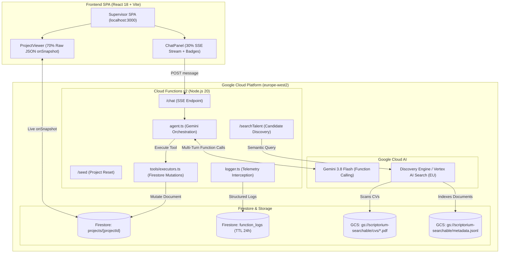

# Scriptorium Talent Hub - Architectural Log & Developer Reference

## Overview & Mission
**Scriptorium Talent Hub** is an agentic, productised talent-management platform and supervisory system designed for creative, localisation, and marketing teams.

- **GCP Project**: `scriptorium-503507`
- **Region**: `europe-west2` (London, UK — strictly enforced for all infrastructure)
- **Core Value Proposition**: Replaces the expensive in-house talent/resource manager by providing a done-for-you, subscription-based service that sources, tests, builds, and maintains private, ready-to-book freelance talent pools with guaranteed 24–48 hour rapid fills.
- **Current Technical Implementation**:
  - **Supervisor Console SPA**: React 18 + TypeScript + Vite + Tailwind CSS featuring a 70/30 split view (70% live Firestore project/pool document viewer, 30% chat console with tool badges and SSE streaming).
  - **Backend Cloud Functions v2**: Node.js 20 / TypeScript endpoints deployed in `europe-west2` providing SSE agent chat (`/chat`), project seeding (`/seed`), and semantic talent search (`/searchTalent`).
  - **Autonomous Agent**: Native Gemini 3.8 Flash (`@google/genai`) function calling agent executing verified state mutations on Firestore documents with thought signature preservation.
  - **Semantic Candidate Search**: Google Cloud Discovery Engine (Vertex AI Search) indexing talent CVs in Google Cloud Storage (`gs://scriptorium-searchable`) with structured JSONL metadata.
  - **Centralised Telemetry**: Real-time console interception and structured logging to the Firestore `function_logs` collection with 24-hour TTL and automated test teardown reporting.

---

## Part I: Business Plan & Product Strategy

### 1. Executive Summary
Scriptorium Talent Hub replaces the in-house talent manager. Creative agencies, localisation teams, and marketing scale-ups typically employ or overload staff to find, vet, onboard, and coordinate freelancers. Scriptorium performs this entire lifecycle at a fraction of the cost.

Clients receive a private, vetted, ready-to-book talent pool, kept continually active and topped up whenever new skills are required. Clients pay a predictable monthly subscription based on pool size and scope.

### 2. The Problem
1. **High Cost**: A dedicated talent or resource manager commands a full salary (£35k–£60k+) plus overhead, which small and mid-sized agencies (10–200 staff) cannot justify.
2. **Reactive Panic-Searching**: When a brief arrives, teams scramble across fragmented platforms to find available talent.
3. **Inconsistent & Unverified Vetting**: Portfolios and CVs fail to verify real craft quality under deadline pressure, and agency leads lack the bandwidth to design and mark tests.
4. **Stale Pools**: Freelancers become unavailable, update rates, or slip in quality without systematic tracking.
5. **Hard-to-Fill Multidisciplinary Roles**: Niche cross-discipline roles (such as transcreation, AI post-editing, and bilingual client service) are notoriously difficult to source through commodity freelance platforms.

### 3. Talent Disciplines Covered
Scriptorium curates and rigorously tests talent across key creative and linguistic domains:
- **Copywriters & Content Writers**: Timed brief written to style guide, evaluating tone range and persuasion.
- **Transcreation Specialists**: Adaptation of brand campaign copy for cultural resonance with rationales.
- **AI Post-Editors**: Review of machine translation and AI-generated copy, turning raw outputs into polished, publication-ready prose across error categories.
- **Translators, Reviewers & Language QA**: Domain-specific translation samples scored by senior linguists.
- **Project Managers & Producers**: Scenario-based evaluation of scope, timeline, risk, and stakeholder management.
- **Account Managers & Client Services**: Role-play and written communication for client escalation and briefs.
- **Visual & Audio Disciplines**: Subtitling specialists, Voice-Over artists, Graphic Designers, Creative Directors, Social Media Creators, and Brand Strategists.

### 4. Competitor Analysis & Strategic Moat

| Competitor | Business Model | Threat Level | Scriptorium Moat & Gap Exploited |
| :--- | :--- | :--- | :--- |
| **YunoJuno** | Freelancer management system + vetted marketplace; percentage markup on freelancer rates (approx 12%). | High (Creative) | Self-service: client still shortlists and manages pools; enterprise-priced; not language-specialised; no provider-run testing. |
| **Cavalry Freelancing** | Roster management platform with AI matching; booking and invoicing. | High (Creative) | Self-service tool. Clients still do the talent-manager work; no language/transcreation specialism. |
| **Language Talent Pool** | Recruitment agency and job board for language professionals; per-placement fees. | Medium–High (Language) | People-dependent, agency-placement model. Scriptorium offers a recurring, productised pool subscription across creative AND language roles. |
| **Juicebox (PeopleGPT)** | AI sourcing search engine for recruiters; per-seat SaaS ($99–$199/mo). | Low (Tool, not service) | Requires a trained recruiter to operate; cannot verify craft quality or test competencies. |
| **Starred / urfuture / CrossPath** | Candidate experience analytics, Gen Z entry-level apps, or headhunter CRMs. | Low | Different segments or recruitment tooling rather than managed talent-as-a-service. |

**The Model Gap**: Generalist marketplaces sell tools; recruiters sell one-off placements. Scriptorium sells **done-for-you pool management as a recurring subscription**, aligning incentives and eliminating disintermediation.

### 5. Service Tiers & Commercial Pricing

```
+-----------------------------------------------------------------------------------+
| Scriptorium Subscription Tiers                                                    |
+-----------------------------------------------------------------------------------+
| Starter: £750/mo   | Up to 15 vetted talents | 1-2 role types | 3 rapid-fill briefs/mo|
| Growth:  £1,800/mo | Up to 40 vetted talents | 3-5 role types | Unlimited briefs  |
| Scale:   From £4,000 | 100+ talents, multi-market | Dedicated talent partner, custom tests|
+-----------------------------------------------------------------------------------+
```

- **Add-ons**:
  - One-off pool build fee for rare or bespoke skill sets.
  - Managed contracting and payroll through compliance partner (small admin fee).
  - Custom test creation and bespoke assessment rubrics.
  - Emergency 24-hour turnaround sourcing.
- **Value Story**: An in-house talent manager costs £40,000–£70,000 fully loaded. A Growth tier plan at ~£21,600/year delivers an active, verified, continually refreshed pool at less than half that cost, with no commission on bookings.

### 6. Go-to-Market & 12-Month Product Roadmap
- **Phase A (Months 0–3: Prove Manually)**: Sign 3–5 design-partner agencies at pilot rates; test 150 freelancers across priority roles (copywriters, transcreation, project managers); operate with lightweight tools.
- **Phase B (Months 3–9: Repeatable Sales & Portals)**: Launch candidate search engine (Vertex AI Search) and Client/Talent Portals; offer 2-week 5-person mini pool pilots; publish industry rate calculators.
- **Phase C (Months 9–24: Scale & Automation)**: Full platform automation of pool upkeep; partner with payments/compliance providers; scale to 100+ subscribed clients.

---

## Part II: Technical Architecture & System Design

### 1. High-Level Architecture

Scriptorium combines Google Cloud Serverless infrastructure (`europe-west2`), Gemini Generative AI, and Vertex AI Search (Discovery Engine) into a unified supervisory environment:



### 2. Core Subsystems

#### A. Supervisor SPA (`frontend/`)
- **Layout & Multi-Project Tab Architecture**:
  - **Horizontal TabBar (`TabBar.tsx`)**: Mounted beneath the header, supporting pinned system tabs and dynamic project tabs:
    - **Pinned Emails Tab**: Shows unassigned incoming email badge count and switches to the dedicated `EmailHub` full-width triage workspace.
    - **Dynamic Project Tabs**: Displays clean project titles (e.g. "Infosys") without IDs, with active indicator and tab close buttons (`✖`). Tabs can be closed down to 0, cleanly falling back to the pinned Emails tab without resurrecting ghost project IDs.
    - **New Tab Trigger (`+`)**: Opens `OpenProjectModal.tsx` allowing the user to select from recent Firestore projects, input an existing `pr-xxxxxx` ID, or auto-generate and seed a new project.
    - **Startup & Tab Lifecycle**: On first visit (empty session/localStorage), the app queries Firestore for existing projects and opens the most recent valid project tab; if the database is empty, it lands cleanly on the pinned Emails tab rather than hardcoding a phantom project ID.
  - **Project Tab Sessions (`ProjectTabSession.tsx`)**: Each project tab mounts an independent session keeping its own Firestore document and message listeners active in memory (`hidden` when inactive). This preserves background SSE agent streaming and local input state seamlessly across tab switches:
    - **Left Panel (70%)**: `ProjectViewer.tsx` displays the structured project inspector featuring a two-column sub-layout: a left-hand domain navigation sub-sidebar (Overview & Status, Brief & Scope, Requirements & Tags, Deliverables & Files, Communications) and a central inspector pane with reactive cards, status pills, count badges, and an in-header toggle to switch to the formatted Raw JSON view (`data-testid="project-raw-json"`). The Raw JSON view includes an interactive, expandable `_subcollections` tree for project subcollections (e.g. `messages` subcollection) with on-demand lazy loading (`fetchProjectMessages` / `data-testid="subcollection-messages-toggle"`) when the expander is clicked, document count pills, manual reload triggers, and full JSON clipboard export (`data-testid="copy-json-btn"`). If a project document does not yet exist in Firestore, it presents an actionable **"Initialize / Seed Project"** button to bootstrap the document in place with one click.
    - **Right Panel (30%)**: `ChatPanel.tsx` handles natural language conversations with the supervisor agent via Server-Sent Events (SSE). Streams tokens, status tickers, and tool execution badges (`ToolCallBadge.tsx`). The chat interface features consistent complementary theming: vibrant blue (`bg-blue-600`) for the Supervisor messages and a complementary deep purple shade (`bg-[#1c1836]` with `border-purple-500/30`) for Agent replies with inline bold markdown parsing. Embedded tool call badges feature an interactive expander (`data-testid="tool-call-expander"`) allowing users to collapse or expand raw parameters, results, and error details on demand while keeping the conversation compact and readable.
  - **Email Hub Workspace (`EmailHub.tsx`)**: Split-pane triage workspace for inbound and outbound messages:
    - **Left List**: Segmented filter control: **Inbox** (merged repository emails, `data-testid="email-filter-inbox"`), **Unassigned** (messages awaiting triage where `!projectId`, `data-testid="email-filter-unassigned"`), and **Assigned** (project-associated messages, `data-testid="email-filter-assigned"`), defaulting to the Unassigned view on mount for immediate triage focus, with search, timestamps, and sender previews.
    - **Quick Assignment Bar**: Renders quick-assign buttons for currently open project tabs displaying the clean project name (`Assign to <Project Name>` via `projectTitles` prop) and `data-project-id`, omitting raw IDs and `(active)` tags for clear, human-readable triage.
  - **Standalone Project View (`StandaloneProjectView.tsx` / `?project=<id>`)**:
    - Query parameter `?project=<projectid>` activates a dedicated, full-width/full-height single-project inspector mode, distinct from `?projectId=` (which powers the supervisor multi-tab workspace).
    - Completely omits top `Header`, `TabBar`, and `ChatPanel`, presenting an unencumbered, distraction-free view of `ProjectViewer`.
    - Retains full interactive capability: domain navigation sub-sidebar (Overview & Status, Brief & Scope, Requirements & Tags, Deliverables & Files, Communications), Structured Inspector, formatted Raw JSON mode with expandable subcollections, and the 1-click "Initialize / Seed Project" button when a record has not yet been seeded.
    - Dynamically sets `document.title` to `${project.title || projectId} | Scriptorium`.
    - Validates project ID against `isValidEntityId(id, 'pr')` and provides a clean, dark-themed "Project Not Found or Invalid ID" recovery card with direct ID input and a return shortcut to the Supervisor Console.
    - **Supervisor Dashboard "Project Only" Links**:
      - `ProjectViewer` header toolbar features an external link button (`data-testid="project-only-link"`) next to the sync status, allowing supervisors to open the project in standalone full-width mode with one click.
      - `ProjectViewer` domain sub-sidebar footer includes a `data-testid="sidebar-project-only-link"`.
      - `OpenProjectModal` list includes an external link button (`data-testid="modal-project-only-link-${p.id}"`) next to each available project in the database.
- **Header (`Header.tsx`)**: Streamlined single-row header (`h-12`) featuring the Scriptorium terminal logo, title, clean "Supervisor" badge, and live Firestore connection status pill. Redundant project ID and GCP indicators have been removed from the header as active projects are explicitly managed and identified in the TabBar directly below.


#### B. Cloud Functions Backend (`functions/`)
- **Runtime**: Node.js 20, TypeScript, Firebase Functions v2, deployed strictly to `europe-west2`.
- **Endpoints**:
  - `POST /chat`: Initiates an SSE stream (`text/event-stream`). Emits `tool_call_start`, `tool_call_result`, `agent_text`, and `done` events. Supports optional `fileUri` and `fileMimeType` for multimodal document inspection.
  - `POST /upload`: Accepts base64 encoded files (`{ filename, mimeType, content }`), uploads to `gs://scriptorium-uploads-503507/uploads/`, and returns the GCS URI.
  - `GET/POST /seed`: Idempotently creates or resets the specified project document (default: `projects/pr-7k4x9q`).
  - `POST /emailService`: Dispatches outbound transactional emails (thank you, acceptance, renewals, credentials, notifications) across the platform via Resend API or local MailDev SMTP.
  - `POST /searchTalent`: Accepts a semantic candidate search query and optional metadata filters, calling the Discovery Engine API with GoogleAuth credentials.
  - `GET /downloadArtifact`: Validates timeboxed HMAC SHA-256 signature and streams project artifact files directly from GCS (`gs://scriptorium-project-artifacts-503507/projects/{projectId}/{filename}`).
- **Tools Engine (`functions/src/tools/`)**:
  - `lookupProjectRecord`: Looks up and retrieves full Firestore project document details by project ID (`pr-xxxxxx`).
  - `listRecentProjects`: Retrieves summary of recently active or created projects (IDs, titles, status, tags).
  - `lookupProjectArtifact`: Looks up saved project deliverable, brief, or dossier artifact metadata by artifact ID (`ar-xxxxxx`) or name.
  - `updateProjectLifecycleStage`: Transitions project lifecycle state (`draft`, `in_progress`, `blocked`, `completed`).
  - `renameProjectDocument`: Renames the project document title.
  - `updateProjectBriefDescription`: Updates the textual scope and project brief.
  - `addProjectRequirementTag`: Appends required competencies and deliverable tags using `FieldValue.arrayUnion`.
  - `removeProjectRequirementTag`: Removes tags using `FieldValue.arrayRemove`.
  - `searchTalentPool`: Queries vetted linguists and creative candidates via Discovery Engine / Vertex AI Search, supporting structured experience/vetting filters and token-efficient compact candidate cards.
  - `indexTalentCv`: Registers and indexes candidate CV profiles directly into the Discovery Engine datastore branch for rapid search availability.
  - `readCandidateEmailMessage`: Inspects, searches, and reads received or dispatched candidate/hirer email communications from Resend or Firestore `emails` repository.
  - `sendCandidateEmailMessage`: Dispatches transactional outbound email communications to candidates or hirers via Resend API, logs records into Firestore `emails` repository, and automatically appends the message into `projects/{projectId}.emails`.
  - `getProjectsFromEmailSender`: Identifies and lists all Scriptorium projects that have corresponded with, received messages from, or contacted a specific candidate or email sender address.
  - `assignEmailToProject`: Explicitly moves, associates, and stores an inbound or unassigned email message into a specific Scriptorium project document (`projects/{projectId}.emails`).
  - `listUnassignedInboxEmails`: Inspects and lists unassigned incoming candidate or client emails waiting in the inbox that have not yet been associated with any Scriptorium project.
  - `saveProjectArtifact`: Promotes uploaded briefs, dossiers, or deliverables from `scriptorium-uploads-503507` into the permanent project artifacts bucket (`gs://scriptorium-project-artifacts-503507/projects/{projectId}/{filename}`) and registers the artifact metadata record and optional comment in Firestore `projects/{projectId}.artifacts`.
  - `getProjectArtifactDownloadUrl`: Looks up a saved project artifact by ID, name, or comment, and generates a secure timeboxed download URL.
  - *Modular Tools Engine*: Concrete executors are partitioned by domain into `projectExecutors.ts`, `talentExecutors.ts`, and `emailExecutors.ts` with shared types in `types.ts`. The unified facade and dispatcher `executors.ts` (`dispatchToolCall`) translates domain-named agent tool calls to the respective domain executors.

#### C. Cloud Storage & Candidate Repository
- **Uploads Bucket**: `gs://scriptorium-uploads-503507` (Region: `europe-west2`, Standard storage class, uniform bucket-level access) for user/agent uploaded briefs, dossiers, and resumes.
- **Project Artifacts Bucket**: `gs://scriptorium-project-artifacts-503507` (Region: `europe-west2`, Standard storage class, uniform bucket-level access) for permanent client deliverables, approved briefs, and dossiers organized under `projects/{projectId}/{filename}`.
- **Searchable Bucket**: `gs://scriptorium-searchable` (Region: `europe-west2`) containing CV PDFs (`cvs/*.pdf`) and candidate index metadata (`metadata.jsonl`).
- **Semantic Talent Search Datastore**: `talent-search-connector_1785766300992_gcs_store` (Location: `eu` / `eu-discoveryengine.googleapis.com`).

#### D. Telemetry & Observability (`functions/src/logger.ts`)
- All Cloud Functions invoke `setupFirestoreLogging('backend')`, automatically intercepting `console.log`, `console.info`, `console.warn`, and `console.error`.
- Log records are written to the Firestore `function_logs` collection with `timestamp` (server timestamp), `service`, `level`, `message`, `details` (sensitive keys masked), and a 24-hour TTL (`expireAt`).
- All Playwright test fixtures (`tests/loggingHelper.js`) unconditionally tail and print recent `function_logs` upon test teardown.

#### E. Email Communications & Project Association (`functions/src/tools/emailExecutors.ts`, `frontend/src/components/InboxDrawer.tsx`)
- **Resend Integration**: Dispatches transactional emails via Resend API using verified sender `info@seamcode.co.uk`.
- **Project Email Schema (`ProjectEmail`)**:
  - `id`: `em-[a-z0-9]{6}`
  - `direction`: `'inbound' | 'outbound'`
  - `from`, `to`, `subject`, `body`: text / recipient metadata
  - `timestamp`: ISO timestamp
  - `assignedAt`?: ISO timestamp
  - `resendId`?: string
- **Automatic Outbound Association**: When the supervisor agent dispatches an outbound email via `sendCandidateEmailMessage`, it writes to `emails/{emailId}` and automatically appends the record into `projects/{projectId}.emails`.
- **Explicit Inbound Association**: Incoming emails sit unassigned in the Resend/Firestore inbox (`emails` where `projectId == null`). They are visible and triaged directly from the pinned **Emails** tab (`EmailHub.tsx`) with real-time unassigned badge counter and 1-click project assignment.

- **Agent Discovery & Move Tools**:
  - `getProjectsFromEmailSender`: Discovers all projects associated with a given sender address.
  - `assignEmailToProject`: Explicitly moves and attaches an email into `projects/{projectId}.emails`.
  - `listUnassignedInboxEmails`: Lists unassigned incoming messages for agent triage.
- **Fail-Fast Credential Isolation**:
  - `RESEND_API_KEY` is loaded strictly from environment files (`.env`, `.env.local`, `.env.production`). No hardcoded API keys or fallback strings are permitted in production or test files. Missing keys trigger explicit error responses (`MISSING_RESEND_API_KEY`).
  - Standalone binaries (e.g. `tools/resend`) are excluded via `.gitignore`.

#### F. Strict Firestore Record ID Conventions & Dedicated Agent Lookup Tools (`functions/src/entityId.ts`)
- **Strict Format**: `^[a-z]{2}-[a-z0-9]{6}$` (two lowercase letters, hyphen, followed by six lowercase alphanumeric characters).
  - Entropy: $36^6 \approx 2.17 \times 10^9$ combinations, drastically reducing collision probability compared to pure numeric digits.
- **Strict Entity Prefix Taxonomy**:
  | Prefix | Entity / Collection | Description | Example |
  | :--- | :--- | :--- | :--- |
  | **`pr-`** | `projects/{projectId}` | Core project specifications, briefs, and status documents | `pr-7k4x9q` |
  | **`ms-`** | `projects/{projectId}/messages/{messageId}` | Chat conversation turns and streaming tool interactions | `ms-a8f3k2` |
  | **`em-`** | `emails/{emailId}` | Inbound/outbound email communications & audit records | `em-v9d2m5` |
  | **`ar-`** | `project.artifacts[].id` | Deliverables, approved briefs, and dossiers in project repo | `ar-4k8x2q` |
  | **`tl-`** | Talent Datastore / CV Profiles | Candidate CV profiles registered in Discovery Engine / datastore | `tl-3n7w1z` |
- **Exemptions**:
  - `function_logs/{document}` is explicitly exempt from the `[a-z]{2}-[a-z0-9]{6}` rule because it is high-throughput backend telemetry not queried or cited by conversational agents.
- **Fail-Fast Validation**:
  - `assertValidEntityId(id, prefix?)` throws explicit errors immediately if any endpoint, agent call, or Firestore mutation receives a malformed ID.
- **Dedicated Agent Discovery & Lookup Tools**:
  - Rather than guessing IDs, agents discover existing entities using dedicated tools:
    1. `lookupProjectRecord`: Fetches complete document state for a project by `projectId` (`pr-xxxxxx`).
    2. `listRecentProjects`: Lists recent projects with IDs, titles, status, and tags.
    3. `lookupProjectArtifact`: Inspects deliverable metadata by `artifactId` (`ar-xxxxxx`) or filename.
    4. `readCandidateEmailMessage`: Inspects and searches email records by `emailId` (`em-xxxxxx`) or keyword.

#### G. Supervisor Dashboard Access Token Security Guard (`frontend/src/App.tsx`, `frontend/src/components/AccessDenied.tsx`, `frontend/src/config.ts`)
- **Overview**: Protects the supervisor console SPA from unauthorized access by requiring an access token provided via URL query parameter (`?token=<32-char-hex>`).
- **Fail-Fast Configuration**:
  - Configured via `VITE_SUPERVISOR_ACCESS_TOKEN` in `.env`, `.env.local`, and `.env.production`.
  - Missing or blank configuration throws an immediate fail-fast error during app bootstrap via `config.ts`.
- **Authentication Lifecycle & URL Hygiene**:
  - On initial visit, the gate checks `sessionStorage` (`scriptorium_supervisor_token`) and URL query parameters (`?token=...`).
  - When a valid query token is detected, it is immediately persisted to `sessionStorage`, and stripped from the address bar via `window.history.replaceState` to prevent token leakage in screen shares, history, or bookmarks.
  - Subsequent tab switches, navigations, and reloads authenticate transparently through `sessionStorage`.
- **Access Denied Experience (`AccessDenied.tsx`)**:
  - Missing or mismatched tokens render a dedicated full-screen 403 Access Denied view (`data-testid="access-denied-screen"`) matching Scriptorium's dark terminal theme.
  - While unauthenticated, no Firestore listeners, email subscriptions, or workspace components are mounted.
- **Automated Testing & Test Runner Integration**:
  - `tests/loggingHelper.js` automatically provisions the supervisor token to test browser contexts via `context.addInitScript` so existing E2E suites run uninterrupted.
  - Tests can set `window.__DISABLE_TEST_SUPERVISOR_AUTH__ = true` to assert on unauthorized states (`tests/supervisorDashboard_missingOrInvalidToken_rendersAccessDenied_test.spec.js`).
  - Unit test suite (`frontend/src/tests/supervisorTokenGuard_missingOrInvalidToken_rendersAccessDenied_test.tsx`) validates missing, invalid, and valid token flows in jsdom.

---

## Part III: Key Directories and Files

```
scriptorium/
├── .agents/
│   └── AGENTS.md                  # Agent directives and operational rules
├── .env.example                   # Environment configuration template
├── .env.local                     # Local development & emulator configuration
├── .env.production                # Live GCP production configuration
├── .firebaserc                    # Firebase project binding (scriptorium-503507)
├── firebase.json                  # Firebase deployment & emulator configuration
├── firestore.rules                # Security rules for projects & function_logs
├── GEMINI.md                      # Complete architectural and business specification
├── package.json                   # Root orchestrator scripts (npm test, npm run logs)
├── scripts/
│   ├── check_services.js          # Pre-flight health checker for local services
│   ├── provision_uploads_bucket.js # Provisions GCS uploads bucket in europe-west2
│   ├── provision_project_artifacts_bucket.js # Provisions GCS project artifacts bucket in europe-west2
│   ├── run_tests.js               # Interactive and CLI Playwright test runner
│   └── tail_logs.js               # Real-time Firestore function_logs tailing tool
├── gcloud/                        # Microservices & Outbound Handlers
│   └── email/                     # Transactional Email Service (Express / CommonJS)
│       ├── config.js              # Environment & Firestore telemetry configuration
│       ├── emailDispatcher.js     # Dispatch helper routing to Resend API / MailDev
│       ├── emailTemplates.js      # Email templates & EmailService class
│       └── index.js               # Microservice entry point & action handlers
├── tools/                         # External CLI tooling
│   └── resend                     # Resend CLI executable binary
├── tests/                         # E2E integration test suite (Playwright)
│   ├── cloudHelpers.js            # Firestore & Functions emulator helper utilities
│   ├── loggingHelper.js           # Playwright fixture with mandatory log tailing
│   ├── playwright.config.js       # Playwright config (port 3000, 120s timeout)
│   ├── testSearchHelpers.js       # Discovery Engine test lifecycle & GCS injection
│   ├── chat_fileUpload_returnsExtractedId_test.spec.js # Endpoint test: GCS upload + 8-digit ID extraction
│   ├── email_sendAndAgentReadBack_verifiesDifferentEmail_test.spec.js # Endpoint test: Email send + agent read back
│   ├── supervisorAgent_emailSendAndReceive_verifiesWithResendApi_test.spec.js # Browser E2E: Email send & receive prompt testing
│   ├── searchTalent_validQuery_returnsVertexSearchResults_test.spec.js
│   ├── supervisorAgent_fileUpload_attachesAndStreamsExtractedId_test.spec.js # Browser E2E: File upload + chat stream
│   ├── supervisorConsole_initialLoad_rendersSplitLayoutAndControls_test.spec.js
│   ├── supervisorConsole_projectTabs_opensSwitchesAndViewsEmails_test.spec.js # Browser E2E: Tabbed workspace, project tabs, Email Hub & modal
│   ├── supervisorConsole_incomingEmailInbox_assignsEmailAndUpdatesProjectViewer_test.spec.js # Browser E2E: Incoming email inbox, manual assignment & agent project lookup
│   ├── supervisorAgent_projectArtifactLifecycle_uploadsPersistsAndDownloadsWithSignedUrl_test.spec.js # Browser E2E: Artifact lifecycle, persistence & secure download URL
│   ├── supervisorConsole_createNewProjectAndAddTag_tagAppearsInInspector_test.spec.js # Browser E2E: UI project creation, tab navigation & agent tag addition
│   └── supervisorAgent_multiTurnTools_mutatesFirestoreAndUpdatesViewer_test.spec.js
├── functions/                     # Backend Cloud Functions (Node.js 20 / TypeScript)
│   ├── package.json
│   ├── tsconfig.json
│   ├── vitest.config.ts           # Vitest configuration for backend tests
│   ├── src/
│   │   ├── index.ts               # HTTP endpoints (/chat, /seed, /searchTalent, /upload, /downloadArtifact)
│   │   ├── config.ts              # Fail-fast server configuration validator
│   │   ├── types.ts               # Data models (ProjectDocument, ToolCallExecution, FileAttachment, ProjectArtifact)
│   │   ├── entityId.ts            # Centralized entity ID generator and validator ([a-z]{2}-[a-z0-9]{6})
│   │   ├── firestore.ts           # Admin SDK client & seeding logic
│   │   ├── storage.ts             # Cloud Storage uploads & buffer management
│   │   ├── artifactTokens.ts      # HMAC SHA-256 timeboxed token generator & validator
│   │   ├── logger.ts              # Centralized Firestore logging & sanitization
│   │   ├── agent.ts               # Gemini agent loop & SSE streaming dispatcher
│   │   ├── vertexSearch.ts        # Vertex AI Search / Discovery Engine client
│   │   └── tools/
│   │       ├── declarations.ts    # Native Gemini FunctionDeclaration schemas
│   │       ├── types.ts           # Tool parameter interfaces & execution result models
│   │       ├── projectExecutors.ts # Firestore project lifecycle, document state, lookup & artifact handlers
│   │       ├── talentExecutors.ts # Vertex AI Search & candidate CV indexing handlers
│   │       ├── emailExecutors.ts  # Outbound & inbound candidate email handlers (Resend & Firestore)
│   │       └── executors.ts       # Unified tool dispatcher and re-export facade
│   └── tests/                     # Backend unit tests
│       ├── parseGcsUri_invalidUri_throwsExplicitError_test.ts
│       ├── logToFirestore_validParameters_writesToFunctionLogs_test.ts
│       ├── searchVertexAI_validQuery_returnsMatchingTalents_test.ts
│       ├── executeUpdateStatus_validStatus_updatesProjectDocument_test.ts
│       ├── executeUpdateStatus_invalidStatus_returnsExplicitError_test.ts
│       ├── executeAddTag_newTag_appendsTagArray_test.ts
│       ├── executeRenameProject_emptyTitle_returnsExplicitError_test.ts
│       ├── executeSearchTalentPool_validParameters_returnsCompactCandidates_test.ts
│       ├── executeIndexTalentCv_validParameters_indexesCandidateDocument_test.ts
│       ├── executeSaveProjectArtifact_validParameters_savesArtifactAndUpdatesProject_test.ts
│       ├── executeGetProjectArtifactDownloadUrl_validQuery_returnsSignedDownloadUrl_test.ts
│       ├── executeEmailExecutors_missingParameters_returnsExplicitErrors_test.ts
│       ├── emailConfig_refactoredModule_exportsAndExecutesCorrectly_test.ts
│       ├── generateEntityId_allPrefixes_conformsToStrictAlphanumericFormat_test.ts
│       ├── executeLookupTools_validParameters_retrievesProjectAndArtifactRecords_test.ts
│       ├── executeAssignEmailToProject_validEmail_associatesEmailWithProject_test.ts
│       ├── executeGetProjectsFromEmailSender_validSender_returnsMatchingProjects_test.ts
│       └── toolDeclarations_allToolDeclarations_adhereToDomainContextRule_test.ts

└── frontend/                      # Supervisor SPA (React 18 + Vite + Tailwind)
    ├── package.json
    ├── vite.config.ts
    ├── src/
    │   ├── main.tsx               # SPA entrypoint
    │   ├── App.tsx                # Multi-project tabbed workspace container
    │   ├── config.ts              # Fail-fast frontend configuration validator
    │   ├── types.ts               # Frontend data contracts
    │   ├── components/
    │   │   ├── Header.tsx         # Connection status & seed button
    │   │   ├── TabBar.tsx         # Pinned Emails, project tabs, + new tab trigger
    │   │   ├── ProjectTabSession.tsx # Isolated 70/30 session maintaining memory state
    │   │   ├── ProjectViewer.tsx  # 70% pane: live JSON document viewer
    │   │   ├── ChatPanel.tsx      # 30% pane: supervisor chat & SSE feed
    │   │   ├── EmailHub.tsx       # Dedicated full-screen email triage workspace
    │   │   ├── InboxDrawer.tsx    # Slide-over quick triage drawer from header
    │   │   ├── OpenProjectModal.tsx # Project picker & new project creation modal
    │   │   └── ToolCallBadge.tsx  # Visual tool execution cards
    │   ├── services/
    │   │   ├── entityId.ts        # Frontend [a-z]{2}-[a-z0-9]{6} generator & validator
    │   │   ├── firebase.ts        # Client SDK setup, onSnapshot listeners & query helpers
    │   │   └── api.ts             # SSE stream client & REST helpers
    │   └── tests/                 # Frontend DOM unit tests
    │       ├── projectViewer_loadedProject_rendersRawJson_test.tsx
    │       ├── tabBar_multipleTabsRendered_switchesAndClosesTabs_test.tsx
    │       └── toolCallBadge_executingState_showsExecutingBadge_test.tsx
```

---

## Part IV: Conventions, Rules & Directives

### 1. GCP Project & Region Constraints
- **Project ID**: `scriptorium-503507`
- **Region**: `europe-west2` (London, UK)
- **Constraint**: All GCP infrastructure (Cloud Functions, Firestore, Storage buckets) must reside strictly in `europe-west2`. Agents must never create or configure infrastructure in any other region.

### 2. Fail Fast & Resilience
- Never introduce silent default fallbacks for missing template files, prompt configurations, required environment variables, or authenticated states.
- If a required parameter is missing from an endpoint payload, database lookup, or environment variable, throw an explicit error immediately.
- Do not insert mock account names (e.g. `@example.com`) or dummy values into production code paths.

### 3. Service Pre-Flight Assertions (Mandatory)
- Every Playwright test spec MUST invoke `await assertServicesRunning(testConfig)` as its very first action.
- The pre-flight check validates:
  1. Frontend SPA (Port 3000)
  2. Cloud Functions Emulator (Port 5001)
  3. Firestore Emulator (Port 8080)
- **Multi-Method Health Probe**: To avoid false negatives across Node 20+, dual-stack IPv4/IPv6, and sandbox boundary environments, verification uses a 3-tier probe:
  1. *Direct TCP Socket Probe* (`net.connect` on `127.0.0.1` and `::1`).
  2. *HTTP Handshake Probe* (`http.request`).
  3. *Kernel State Probe* (verifying `0A` `TCP_LISTEN` state in `/proc/net/tcp` and `/proc/net/tcp6`).
- If any service is unreachable, tests fail fast immediately with a clear error identifying the offline service.

### 4. Gemini 3.x / Thinking Models - Thought Signatures Rule (CRITICAL)
- When building multi-turn agents with function calling, Gemini 3.x thinking models generate an opaque token `thought_signature` on each `functionCall` part.
- In multi-turn tool loops, the preceding model `candidate.content` **must be echoed back intact into the conversation history array** (`contents.push(candidate.content)`).
- Never discard or reconstruct the model turn into a synthetic `{ functionCall: { name, args } }` object. Stripping `thought_signature` triggers a fatal API rejection: `400 INVALID_ARGUMENT: Function call is missing a thought_signature in functionCall parts`.

### 5. Firestore `function_logs` Telemetry & Test Tail Output
- All Cloud Functions log operations, endpoint invocations, and agent tool dispatches to the Firestore `function_logs` collection via `setupFirestoreLogging()` and `logToFirestore()`.
- Documents include `timestamp` (server timestamp), `service`, `level`, `message`, `details` (sanitized/masked), and a 24-hour TTL (`expireAt`).
- ALL Playwright tests using `tests/loggingHelper.js` MUST unconditionally output the chronological tail of `function_logs` recorded during that test run (`where('timestamp', '>=', startTime)`). This output is printed prominently to stdout during fixture teardown and attached to test results.

### 6. Firestore Undefined Properties Setting
- `db.settings({ ignoreUndefinedProperties: true })` must remain enabled in `functions/src/firestore.ts` to prevent runtime serialization failures when persisting optional message metadata (e.g. `toolCalls[].error` or `result`).

### 7. Process & Testing Boundaries
- Never start long-running local frontend or backend server processes automatically; the user starts them.
- Agents may only run LOCAL tests sequentially, one at a time.
- Test naming convention is strictly: `methodname_initialstate_expectedbehaviour_test()`.
- All DOM element assertions must use `data-testid` attributes wherever possible.
- Cloud Functions must be rebuilt (`npm run build` in `/functions`) after any backend modification.

### 8. Tool Naming & Domain Abstraction Rule (Mandatory)
- **Decoupled Infrastructure vs. Contextual Agent Tools**: Backend endpoints and storage operations (Vertex AI Search, Cloud Storage, Firestore updates) remain generic infrastructure primitives and do not need to know conversational context.
- **Contextual Agent Tools**: Tools exposed to the Gemini agent (`functions/src/tools/declarations.ts`) MUST have domain-specific, business-contextual names derived from Scriptorium product strategy (e.g. `indexTalentCv`, `searchTalentPool`, `updateProjectLifecycleStage`, `addProjectRequirementTag`).
- **Translation Layer**: `functions/src/tools/executors.ts` (`dispatchToolCall`) acts as the adapter mapping domain tools to generic backend operations. Multiple distinct agent tools may target the same underlying mutation if they serve distinct user intents.
- **Mandatory 3-Part Description Schema**: Every tool declaration description must contain:
  1. *Business Intent*: Why and when the operation is executed in Scriptorium.
  2. *User Trigger Phrases*: Literal conversational examples (`Use when the supervisor asks to...`).
  3. *Negative Guardrails*: Explicit exclusions (`Do NOT use this tool for...`).

---

## Part V: Developer Workflows & Commands

### 1. Pre-Flight Health Check
Verify that local development servers and emulators are operational:
```bash
npm run check:services
```

### 2. Running E2E Tests (Playwright)
```bash
# Interactive test runner menu
npm test

# Run a specific test by name or keyword
npm run test:e2e -- searchTalent
npm run test:e2e -- supervisorAgent
npm run test:e2e -- supervisorConsole

# Or invoke the test script directly:
node scripts/run_tests.js searchTalent local 1
```

### 3. Running Unit Tests (Vitest)
Unit tests must be executed sequentially, one at a time:

```bash
# Backend unit tests (from /functions):
cd functions
npx vitest run tests/toolDeclarations_allToolDeclarations_adhereToDomainContextRule_test.ts
npx vitest run tests/logToFirestore_validParameters_writesToFunctionLogs_test.ts
npx vitest run tests/searchVertexAI_validQuery_returnsMatchingTalents_test.ts
npx vitest run tests/executeUpdateStatus_validStatus_updatesProjectDocument_test.ts
npx vitest run tests/executeUpdateStatus_invalidStatus_returnsExplicitError_test.ts
npx vitest run tests/executeAddTag_newTag_appendsTagArray_test.ts
npx vitest run tests/executeRenameProject_emptyTitle_returnsExplicitError_test.ts
npx vitest run tests/executeSearchTalentPool_validParameters_returnsCompactCandidates_test.ts
npx vitest run tests/executeIndexTalentCv_validParameters_indexesCandidateDocument_test.ts

# Frontend unit tests (from /frontend):
cd frontend
npx vitest run src/tests/projectViewer_loadedProject_rendersRawJson_test.tsx
npx vitest run src/tests/toolCallBadge_executingState_showsExecutingBadge_test.tsx
```

### 4. Tailing Firestore Telemetry Logs
```bash
# Tail local emulator telemetry logs:
npm run logs:local

# Tail live production telemetry logs:
npm run logs
```

### 5. Building Cloud Functions & Frontend
```bash
# Build Cloud Functions (mandatory after changes to functions/):
cd functions && npm run build

# Build Frontend SPA:
cd frontend && npm run build
```

### 6. Environment Configuration
- **`.env.local` (Root)**:
  Used by Playwright test harness (`tests/playwright.config.js`), `scripts/run_tests.js`, and `scripts/check_services.js` for local emulator and dev runs:
  - `LOCAL_BASE_URL=http://localhost:3000`
  - `VITE_API_BASE_URL=http://127.0.0.1:5001/scriptorium-503507/europe-west2`
  - `VITE_USE_EMULATOR=true`
  - `VITE_FIRESTORE_EMULATOR_HOST=127.0.0.1`
  - `VITE_FIRESTORE_EMULATOR_PORT=8080`
  - `FIRESTORE_EMULATOR_HOST=127.0.0.1:8080`
  - `GCP_PROJECT_ID=scriptorium-503507`
  - `GEMINI_API_KEY=...`
- **`.env.production` (Root)**:
  Used when executing against live GCP services (`node scripts/run_tests.js [test] production`):
  - `PROD_BASE_URL=https://scriptorium-503507.web.app`
  - `VITE_API_BASE_URL=https://europe-west2-scriptorium-503507.cloudfunctions.net`
  - `VITE_USE_EMULATOR=false`
  - `GCP_PROJECT_ID=scriptorium-503507`
- **`functions/.env`**:
  ```env
  GEMINI_API_KEY=<your-google-ai-studio-api-key>
  GCP_PROJECT_ID=scriptorium-503507
  GEMINI_MODEL=gemini-3.8-flash
  VERTEX_SEARCH_PROJECT_NUMBER=559751767113
  VERTEX_SEARCH_DATASTORE_ID=talent-search-connector_1785766300992_gcs_store
  VERTEX_SEARCH_LOCATION=eu
  ```
- **`frontend/.env`**:
  ```env
  VITE_FIREBASE_API_KEY=<firebase-api-key>
  VITE_FIREBASE_AUTH_DOMAIN=scriptorium-503507.firebaseapp.com
  VITE_FIREBASE_PROJECT_ID=scriptorium-503507
  VITE_FIREBASE_MESSAGING_SENDER_ID=<sender-id>
  VITE_FIREBASE_APP_ID=<app-id>
  VITE_API_BASE_URL=http://127.0.0.1:5001/scriptorium-503507/europe-west2
  VITE_PROJECT_ID=pr-7k4x9q
  VITE_USE_EMULATOR=true
  VITE_FIRESTORE_EMULATOR_HOST=127.0.0.1
  VITE_FIRESTORE_EMULATOR_PORT=8080
  ```

